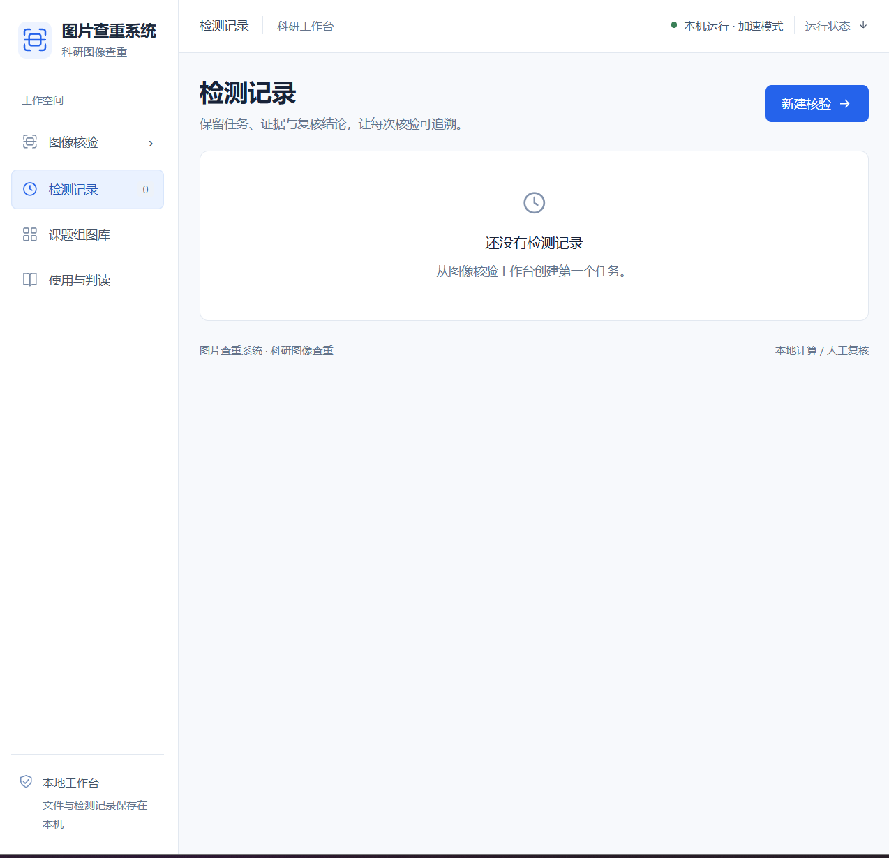
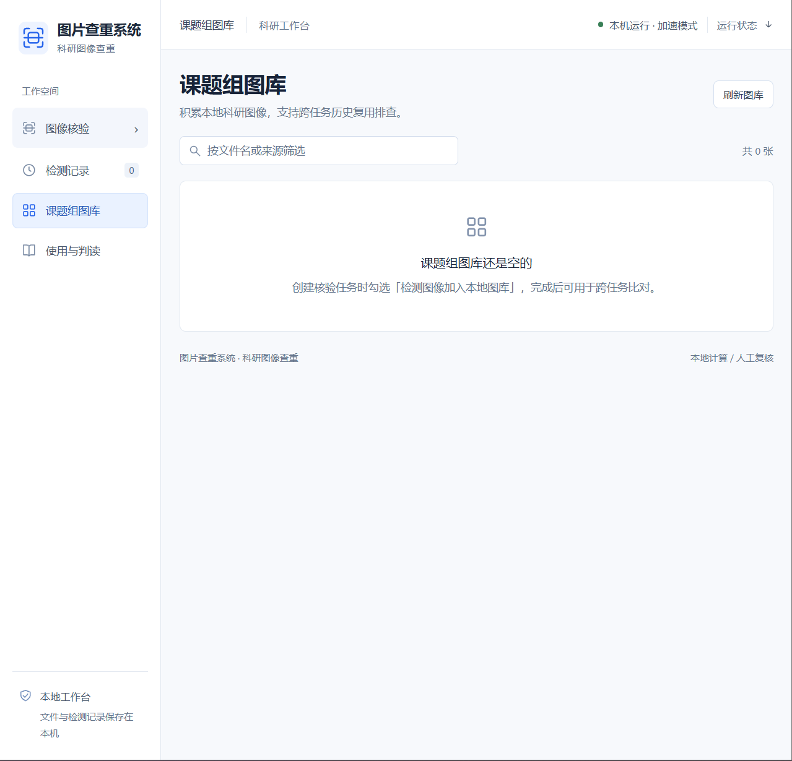
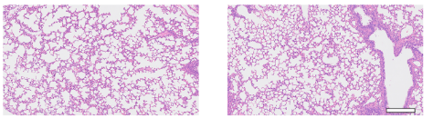
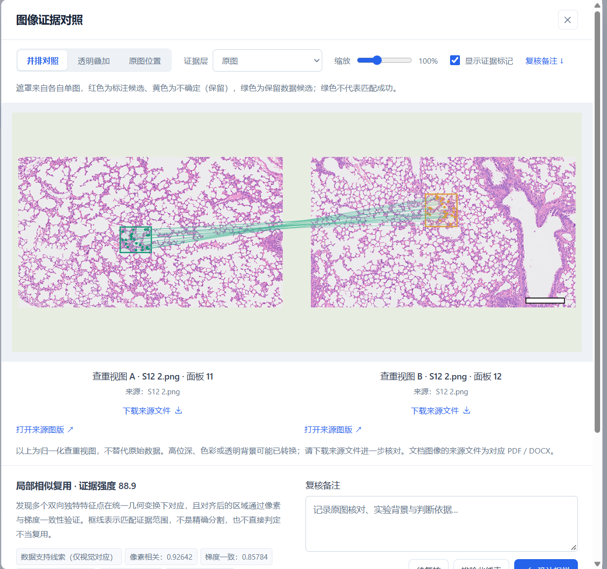

# Image-Duplicate-Detector-for-research-paper
A tool for detecting duplicate and visually similar images in scientific manuscripts, supporting image integrity checks and quality control during research paper preparation and publication.

**A Windows desktop tool for detecting duplicate and visually similar images in scientific research.**

Image Duplicate Detector is designed to assist researchers in identifying potential image duplication and visual similarities during scientific manuscript preparation, internal review, and pre-publication quality control.

The project aims to provide an accessible image-screening utility to support research transparency, scientific integrity, and reliable figure preparation.

## Application Screenshots

### Main Interface

The main workspace provides three inspection modes:
- Batch image duplication screening
- PDF and Word document image inspection
- Side-by-side image comparison

### Inspection History

Review previous inspection tasks and maintain traceable screening records.

### Research Image Library

Maintain a local research image library for cross-task image comparison. 
---

## Detection Demonstration

### Example: Detection of Transformed and Reused Image Regions

**Original and modified images**

**Automated detection results**

A very small region from the original histological image was cropped, inverted, and stretched before being inserted into another image.

Despite these transformations, the software successfully identified the locally reused image region and highlighted the corresponding matching areas.

This example demonstrates the potential of the system for detecting localized image reuse in scientific figures, including content that has undergone geometric transformations. 

Installation and Version History
Windows x64: Download the latest packaged release.

For detailed extraction, launch and troubleshooting instructions, see [Installation and Usage](INSTALLATION.md).

For a record of released features and limitations, see the [Changelog](CHANGELOG.md).
Source Code Status
The downloadable Windows application is available under Releases. The original application source code has not yet been published in this repository. The GitHub-generated "Source code" archives currently contain the repository's documentation and image assets; they do not contain the source used to build the Windows executable.

Contributors and maintainers can use the [Source Publication Checklist](SOURCE_PUBLICATION_CHECKLIST.md) when preparing a future reviewed source release.

## Download

**Latest Release: v1.0.0 | Windows x64**

### [Download Image Duplicate Detector for Windows](https://github.com/Kukumo898/Image-Duplicate-Detector-for-research-paper/releases/tag/v1.0.0)

Download the Windows ZIP package from the **Assets** section of the release page.

No separate source-code download is required to obtain the packaged Windows application.

## Key Features

- **Duplicate Image Detection** — Assist in identifying potentially repeated images in research materials.
- **Visual Similarity Screening** — Identify visually similar images that may warrant further examination.
- **Scientific Figure Quality Control** — Support researchers in reviewing images before manuscript submission.
- **Research Integrity Support** — Provide an additional screening step during manuscript preparation and internal quality checks.
- **Windows Desktop Application** — Distribute the application in a convenient executable format.

## Intended Applications

This software is designed for use in research workflows, including:

- Scientific manuscript preparation
- Research figure inspection
- Pre-submission image quality control
- Image duplication screening
- Internal research data review

It may be useful for researchers working with microscopy images, experimental photographs, and other scientific figures.

## Installation

### System

- Platform: Windows
- Distribution: 64-bit Windows ZIP package

### Installation Steps

1. Visit the [Releases](https://github.com/Kukumo898/Image-Duplicate-Detector-for-research-paper/releases) page.
2. Download the Windows ZIP package.
3. Extract the complete archive to a local directory.
4. Keep all application files and supporting folders together.
5. Read `使用说明.txt` for detailed instructions.
6. Double-click `启动图片查重系统.exe` to launch the application.

### Package Contents

| File | Description |
|---|---|
| `启动图片查重系统.exe` | Main application launcher |
| `迁移数据.exe` | Data migration utility |
| `程序文件/` | Supporting application files |
| `使用说明.txt` | User instructions |

**Important:** Do not remove or relocate supporting application files independently, as they may be required for normal operation.

## Usage

After launching the application, follow the instructions provided in the software interface and accompanying user guide to perform image screening.

Potential duplicate or similar images should be manually reviewed to determine whether the detected similarities are scientifically meaningful.

## Scientific Integrity Statement

This software is intended as an **auxiliary image-screening tool**, not as an automated system for determining scientific misconduct.

A similarity match does not necessarily indicate inappropriate image reuse. Legitimate similarities may arise from shared experimental controls, repeated measurements, or other scientifically justified circumstances.

All screening results should be evaluated by qualified researchers in the context of the original experimental data and manuscript.

## Feedback and Contributions

Feedback, bug reports, and feature suggestions are welcome.

Please use [GitHub Issues](https://github.com/Kukumo898/Image-Duplicate-Detector-for-research-paper/issues) to report problems or suggest improvements.

## Project Availability

The packaged Windows application is available through GitHub Releases. The application source code has not yet been included in this repository.

## License

This repository includes an [MIT License](LICENSE). Please refer to the license file for the terms applicable to the repository contents.

---

**Image Duplicate Detector for Research Papers**

*Supporting scientific image quality control and responsible research practices.*
